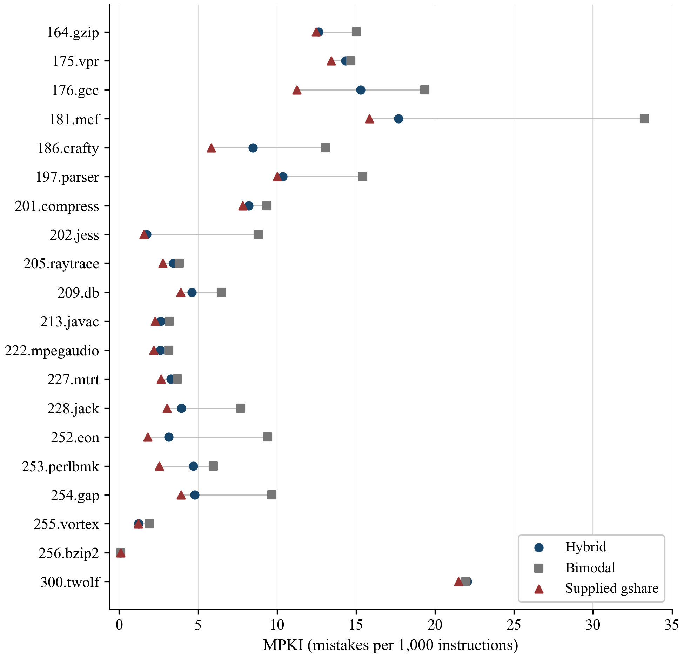

# Assignment 1: Branch Predictor Implementation

**Tadesse Kebede Bahiru**  
**COSC 6385: Computer Architecture**

Repository: [github.com/TadesseK/processor-simulations](https://github.com/TadesseK/processor-simulations)

## Implementation

I implemented the required `pm_predictor` class in `src/my_predictor.h` using both the bimodal and global outcome-prediction components shown in the assignment. The bimodal table supplies a prediction when the global table misses. On a valid global tag hit, the global prediction becomes the final prediction, even when the two components disagree. The resulting predictor learns from resolved outcomes instead of returning the starter class's constant taken prediction.

I used a two-way global table and an XOR history hash, as allowed in the assignment. The implementation covers branch direction prediction; the optional loop and target predictors were left out. The original predictor interface and trace format are unchanged. The implementation is in `src/my_predictor.h`, and all 20 traces are in `traces/`.

### Changes from the starter code

The starter `pm_predictor` constructor and update method were empty, and its prediction method always returned taken with target zero. I added the bimodal and global tables, their initial states, prediction lookup, counter updates, and replacement logic. Table 1 lists these changes and the changes to the driver and runner.

**Table 1. Starter behavior and completed changes.**

| Area | Supplied behavior | Completed behavior |
|---|---|---|
| Required predictor | Constant taken prediction; no learning | Bimodal fallback with tagged global override |
| Predictor state | No initialized hybrid tables or history | 4,096 bimodal counters, 512 two-way global sets, GHR, valid bits, tags, and LRU |
| Update | Empty method | Saturating training, allocation, replacement, and resolved-history update |
| Prediction record | One generic index | Saved bimodal index, global set, tag, hit way, and conditional flag |
| Evaluation driver | Rounded MPKI output | Preserved normal output plus optional exact JSON statistics |
| Runner | C-shell script with additional command dependencies | Portable Python runner that averages exact MPKI values |
| Trace errors | Missing-file and pipe errors could be mishandled | Explicit failure checks, quoted filenames, and checked pipe closure |
| Verification | No assignment-specific checks | Focused tests, appendix replay, complete benchmark logs, and hashes |

### Configuration and state initialization

Table 2 gives the configuration actually measured. The production class instantiates `hybrid_predictor<12, 9, 6>`, so its history width is the sum of nine set-index bits and six tag bits. Default template arguments leave the address unshifted, allocate on every global miss, and initialize each newly allocated counter toward its observed outcome.

**Table 2. Predictor configuration.**

| Component | Configuration |
|---|---|
| Bimodal table | 4,096 two-bit saturating counters, indexed by instruction pointer bits IP[11:0] |
| Global table | 512 sets, two ways per set, six-bit tags, valid bits, two-bit counters |
| History | 15-bit global history register (GHR), containing resolved conditional outcomes with the newest outcome in bit 0 |
| Global key | `hash = (IP XOR GHR) & 0x7fff` |
| Global set | `hash >> 6`, equivalent to hash[14:6] |
| Global tag | `hash & 0x3f`, equivalent to hash[5:0] |
| Replacement | Invalid entries first; otherwise exact two-way LRU |
| Initial state | GHR zero, all global entries invalid, counters weakly not taken (state 1) |

The global entry stores a tag, a counter, and a valid bit. A separate array stores the victim way for each set. With two ways, one bit is sufficient to identify the less recently used way, although the software stores it in a byte. The following exact excerpt shows how these structures are represented.

**Excerpt 1. Table state in `src/my_predictor.h`.**

```cpp
    struct global_entry {
        unsigned int tag;
        unsigned char counter;
        bool valid;
    };

private:
    unsigned char bimodal_[BIMODAL_ENTRIES];
    global_entry global_[GLOBAL_SETS][GLOBAL_WAYS];
    unsigned char lru_[GLOBAL_SETS];
    unsigned int history_;
    pm_update update_;
```

The constructor checks the template widths and calls `reset`. Reset initializes every counter, invalidates both ways in every global set, clears history, and selects way 0 as the initial victim. Initial tags are zero, but invalid bits prevent those zero tags from producing hits. A new simulator process constructs a new predictor for each trace; there is no predictor state carried between benchmarks.

**Excerpt 2. Deterministic reset in `src/my_predictor.h`.**

```cpp
    void reset() {
        history_ = 0;
        for (unsigned int i = 0; i < BIMODAL_ENTRIES; ++i)
            bimodal_[i] = 1; // weakly not taken
        for (unsigned int set = 0; set < GLOBAL_SETS; ++set) {
            lru_[set] = 0;
            for (unsigned int way = 0; way < GLOBAL_WAYS; ++way) {
                global_[set][way].tag = 0;
                global_[set][way].counter = 1;
                global_[set][way].valid = false;
            }
        }
    }
```

Both components use states 0 through 3. States 0 and 1 predict not taken; states 2 and 3 predict taken. State 1 is weakly not taken, so one taken update changes its prediction. State 0 requires two taken updates to reach state 2. Initializing the hybrid and its isolated bimodal baseline identically makes their comparison consistent at reset. The supplied gshare keeps its original state-0 initialization, which is a difference acknowledged in the results.

### Prediction lookup and saved indices

The main diagram uses unshifted IP[11:0] for the bimodal table, so the production predictor does not discard low address bits. The global hash combines the current instruction address with the current resolved conditional history. The high nine hash bits select a set; the low six bits select its tag. Every way in the selected set is checked. A matching tag is accepted only when its valid bit is set.

The prediction record saves the indices before the outcome enters history. This matters because shifting a taken outcome into GHR can change the very tag that must be trained. Recomputing the lookup during update from the new history would train a different context. The saved record also distinguishes conditional branches from calls, returns, and other unconditional branches.

**Excerpt 3. Saved prediction metadata in `src/my_predictor.h`.**

```cpp
class pm_update : public branch_update {
public:
    unsigned int bimodal_index;
    unsigned int global_index;
    unsigned int global_tag;
    int global_way;
    bool bimodal_prediction;
    bool conditional;
};
```

At the beginning of `predict`, the record is initialized, the global hit way is set to `-1`, and the default direction is taken. A nonconditional branch returns immediately with that prediction. Conditional branches continue through the following exact lookup. The bimodal prediction is installed first, making fallback the default. A valid global hit replaces it with that entry's counter direction. There is no chooser table or agreement requirement: the hit itself selects the global component.

**Excerpt 4. Lookup, fallback, and global override in `src/my_predictor.h`.**

```cpp
        const unsigned int address = branch.address >> ADDRESS_SHIFT;
        update_.bimodal_index = address & (BIMODAL_ENTRIES - 1u);
        const unsigned int hash = (address ^ history_) & HISTORY_MASK;
        update_.global_index = hash >> GLOBAL_TAG_BITS;
        update_.global_tag = hash & TAG_MASK;
        update_.bimodal_prediction = bimodal_[update_.bimodal_index] >= 2;
        bool prediction = update_.bimodal_prediction;
        for (unsigned int way = 0; way < GLOBAL_WAYS; ++way) {
            const global_entry &entry = global_[update_.global_index][way];
            if (entry.valid && entry.tag == update_.global_tag) {
                update_.global_way = static_cast<int>(way);
                prediction = entry.counter >= 2;
                break;
            }
        }
        update_.direction_prediction(prediction);
        return &update_;
    }
```

For example, with IP `0x0040` and GHR zero, the bimodal index is 64, the hash is `0x0040`, the global set is 1, and the tag is 0. If both ways are invalid, the final direction comes from bimodal counter 64. A matching but invalid tag cannot change that result. If a valid matching entry later has counter 2 while the bimodal counter is 1, the global entry predicts taken and overrides the bimodal not-taken prediction.

Only the branch information is passed into `predict`. The actual taken flag is supplied afterward to `update`; it is not used to form the prediction. The implementation holds one reusable update record, which fits this driver's immediate `predict` followed by `update` sequence. It does not model several unresolved predictions or speculative histories.

### Counter training, allocation, and replacement

Training uses the same saturating helper for the bimodal counter and a global hit. The bounds prevent repeated taken outcomes from wrapping state 3 to zero, or repeated not-taken outcomes from underflowing zero. The exact helper is short enough to show both cases directly.

**Excerpt 5. Saturating counter training in `src/my_predictor.h`.**

```cpp
    static void train(unsigned char &counter, bool taken) {
        if (taken) {
            if (counter < 3) ++counter;
        } else if (counter > 0) {
            --counter;
        }
    }
```

Update first checks the saved conditional flag. Unconditional branches leave the conditional tables, their replacement state, and GHR unchanged. Every conditional branch trains the saved bimodal entry, whether the final prediction came from bimodal or global. That keeps the fallback component learning while global hits are available. The update then uses the saved set and hit way rather than recomputing them.

**Excerpt 6. Beginning of update in `src/my_predictor.h`.**

```cpp
        const pm_update &saved = *static_cast<pm_update *>(record);
        if (!saved.conditional) return;

        train(bimodal_[saved.bimodal_index], taken);
        int way = saved.global_way;
        const unsigned int set = saved.global_index;
```

On a global hit, the matching counter is trained once. On a miss, the measured configuration always installs an entry. The allocation scan fills the first invalid way before replacing a valid entry. If both ways are valid, the stored LRU victim is selected. The installed tag comes from the saved prediction, and its counter is set to 2 for taken or 1 for not taken. That allocation is already the response to the observed outcome; the new counter is not immediately incremented or decremented again.

**Excerpt 7. Allocation and hit training in `src/my_predictor.h`.**

```cpp
        if (way < 0 && (!ALLOCATE_ON_BIMODAL_MISS ||
                        saved.bimodal_prediction != taken)) {
            // Fill an invalid way before evicting the least recently used way.
            way = lru_[set];
            for (unsigned int candidate = 0; candidate < GLOBAL_WAYS; ++candidate) {
                if (!global_[set][candidate].valid) {
                    way = static_cast<int>(candidate);
                    break;
                }
            }
            global_entry &entry = global_[set][way];
            entry.valid = true;
            entry.tag = saved.global_tag;
            if (PRESERVE_VICTIM_COUNTER) {
                train(entry.counter, taken);
            } else {
                entry.counter = taken ? 2 : 1;
            }
        } else if (way >= 0) {
            train(global_[set][way].counter, taken);
        }
```

After a hit or allocation, `way ^ 1` identifies the other way as the next victim. Accessing way 0 makes way 1 less recent; accessing way 1 makes way 0 less recent. Replacement state changes during update, after the branch resolves. Finally, the actual outcome shifts into GHR and the mask keeps only the newest 15 conditional outcomes.

**Excerpt 8. LRU and history update in `src/my_predictor.h`.**

```cpp
        if (way >= 0) lru_[set] = static_cast<unsigned char>(way ^ 1);
        history_ = ((history_ << 1) | static_cast<unsigned int>(taken)) & HISTORY_MASK;
```

Allocating on every global miss and initializing new counters weakly toward the observed direction are explicit simulation choices. The required structural diagram does not specify a complete allocation or reset policy. The assignment's simplified example also allocates on every miss but retains the victim's old counter before training it. A template option reproduces that illustrative policy. Production uses a fresh counter so the replaced context's confidence is discarded. The optional selective-allocation setting is tested but is not used in any reported benchmark result.

### Worked production example

I ran the following eight-branch example through the default `pm_predictor`. I chose the addresses so the XOR keys revisit global set 5 with different tags. The predictor starts from its normal initial state, with no counters set manually. T means taken and NT means not taken.

Every address has a distinct bimodal index, so each visited bimodal counter starts at 1 and predicts NT. After update it becomes 2 for a taken outcome or 0 for a not-taken outcome. In Table 3, the global-state column lists `tag:counter` for way 0 followed by way 1; “invalid” means the way has not been allocated. All global lookups use set 5. The victim column identifies the way that would be replaced if the next lookup missed in that full set.

**Table 3. Illustrative transitions of the actual production predictor.**

| Step | IP | Actual | History change | Global lookup | Final | Global state after, ways 0; 1 | Next victim |
|---|---|---|---|---|---|---|---|
| 1 | 0x0140 | T | 0 to 1 | Tag 0, miss | NT | 0:2; invalid | 1 |
| 2 | 0x0141 | T | 1 to 3 | Tag 0, way 0 | T | 0:3; invalid | 1 |
| 3 | 0x0142 | NT | 3 to 6 | Tag 1, miss | NT | 0:3; 1:1 | 0 |
| 4 | 0x0146 | T | 6 to 13 | Tag 0, way 0 | T | 0:3; 1:1 | 1 |
| 5 | 0x014f | NT | 13 to 26 | Tag 2, miss | NT | 0:3; 2:1 | 0 |
| 6 | 0x0159 | T | 26 to 53 | Tag 3, miss | NT | 3:2; 2:1 | 1 |
| 7 | 0x0177 | NT | 53 to 106 | Tag 2, way 1 | NT | 3:2; 2:0 | 0 |
| 8 | 0x0129 | NT | 106 to 212 | Tag 3, way 0 | T | 3:1; 2:0 | 1 |

At step 1, `0x0140 XOR 0 = 0x0140`. Its set is `0x0140 >> 6 = 5`, tag is zero, and bimodal index is 320. Both ways are invalid, so state 1 supplies NT. The actual T causes a mistake, trains bimodal counter 320 from 1 to 2, allocates way 0 with tag 0 and counter 2, and changes history to 1.

At step 2, `0x0141 XOR 1 = 0x0140`, selecting the same global entry. Bimodal index 321 is still in state 1, but the matching global counter 2 supplies T. The prediction is correct; that global counter rises to 3 and history becomes 3. If update incorrectly recomputed the key afterward, `0x0141 XOR 3 = 0x0142` would give tag 2. The implementation instead trains the saved tag-0 entry.

Step 3 fills invalid way 1 rather than evicting way 0. Step 4 hits way 0 and makes way 1 the LRU victim. The tag-2 miss at step 5 therefore replaces way 1; the tag-3 miss at step 6 subsequently replaces way 0. Its new counter starts at 2 despite the victim's old state 3, confirming fresh production allocation. Step 7 trains a not-taken hit from 1 to 0. At step 8, global counter 2 incorrectly overrides the correct NT bimodal prediction; the final T is wrong and the global counter decreases to 1. The sequence shows one correct global override and one incorrect global override.

### Storage calculation

The estimated hardware storage is based on logical bits, not C++ object sizes. Each of the 1,024 global entries needs six tag bits, two counter bits, and one valid bit. Two-way LRU needs one bit per set. Table 4 separates those contributions.

**Table 4. Estimated storage of the measured hybrid structures.**

| Structure | Calculation | Bits |
|---|---:|---:|
| Bimodal counters | 4,096 × 2 | 8,192 |
| Global tags, counters, and valid bits | 512 × 2 × (6 + 2 + 1) | 9,216 |
| Global LRU | 512 × 1 | 512 |
| GHR | 15 | 15 |
| Total | 8,192 + 9,216 + 512 + 15 | 17,935 |

Equivalently, `4096*2 + 512*2*(6+2+1) + 512*1 + 15 = 17,935 bits`. Dividing by eight gives 2,241.875 bytes, approximately **2.19 KiB**. The C++ simulator uses byte counters, integer tags, and padded structures, so its host memory use is larger. The update record, virtual-function machinery, and other software overhead are not included in this hardware estimate. The calculation also excludes the optional target, loop, and path-information structures that were not implemented.

## Verification

### Focused checks and recorded outcomes

The predictor compiled without warnings using GCC 13.3.0 with `-O3 -std=c++17 -Wall -Wextra -Wpedantic`. The focused tests also compiled with `-Werror` and passed **eight test groups and 217 checks**. 

The tests drive both components into saturated counter states; force global and bimodal disagreement in both directions; check invalid matching tags and valid nonmatching tags; fill invalid ways before causing LRU replacement; and confirm that saved lookup indices are used during update. They also check the history mask, unchanged conditional state for unconditional branches, both allocation policies, and reset. A repeated sequence after reset produces the same predictions and complete state. Together these checks cover the points where an otherwise plausible hybrid can silently update the wrong entry or make a false hit.

Address and undefined-behavior sanitizer checks passed. Leak checking was disabled because LeakSanitizer could not run in this environment. The diagnostic and test output are saved in `tests/test_results.txt` and `results/unit_tests.log`.

The verification log records successful completion of all 60 runs, matching branch counts, and 29 source and trace hashes. I also checked missing traces, corrupt compressed input, and filenames containing spaces and a quote. Missing or corrupt input produced an error; the quoted filename decoded correctly. The Python runner also completed a single-trace check.

### Reproducing the assignment appendix

I replayed the handout's compact example with the same predictor template but a different configuration: 16 bimodal counters, four global sets, two ways, two-bit tags, four-bit history, and IP shifted by two. This variant is instantiated as `hybrid_predictor<4, 2, 2, 2, false, true>`. Its initial counters follow the handout rather than production reset: bimodal counter `i` starts at `i % 4`; global way 0 at row `r` starts at `r`, and way 1 at `3-r`. All global valid bits still begin clear.

The final `true` enables victim-counter preservation. For example, the first taken miss at row 0 changes its existing counter from 0 to 1. Production would initialize that new entry directly to 2. I used this setting only for the appendix check; the benchmarks use the production initialization described earlier.

All **22 published prediction rows** match: **13 correct predictions and nine mistakes**. Table 5 highlights the rows that show fallback and override, including an incorrect override. The complete replay remains in `tests/appendix_trace.csv`.

**Table 5. Selected verified rows from the assignment's compact example.**

| Step | Branch | GHR before | Actual | Bimodal | Global lookup | Final | Correct? |
|---|---|---|---|---|---|---|---|
| 1 | b1 | 0000 | T | NT | Miss | NT | No |
| 5 | b3 | 1100 | T | NT | Miss | NT | No |
| 6 | b1 | 1001 | T | NT | Hit, T | T | Yes |
| 11 | b1 | 1001 | NT | NT | Hit, T | T | No |
| 14 | b2 | 1010 | NT | T | Hit, NT | NT | Yes |
| 19 | b2 | 1110 | NT | NT | Miss | NT | Yes |
| 22 | b3 | 0011 | T | T | Miss | T | Yes |

The supplied input sequence contains a 23rd branch, but its worked prediction tables end at row 22, so only the 22 published results are compared. I followed the combined Hybrid Predictor Results table and the bimodal fallback rule when the separate global-state table printed a different direction on a miss, at rows 5, 19, and 22. Those misses cannot select a valid global prediction. At row 5 the final result is NT; at row 19 it is NT; and at row 22 it is T. The executed replay verifies those selections rather than treating an unselected direction in the separate table as the final result.

## Experiments and results

### Driver and measurement procedure

I ran all 20 original compressed traces to completion for three predictors. Table 6 records their configurations, including the baseline initialization difference. The bimodal baseline uses the same address indexing and counter training as the hybrid's fallback component. The supplied gshare keeps its 32,768 counters and 15-bit global history, with strongly not-taken initial counters.

**Table 6. Configurations used in the recorded experiments.**

| Predictor | Counter structures | History | Initial counters |
|---|---|---|---|
| Required hybrid | 4,096 bimodal counters and 1,024 tagged global counters | 15 conditional outcomes | State 1; new global entries set toward actual outcome |
| Isolated bimodal | 4,096 address-indexed counters | None | State 1 |
| Supplied gshare | 32,768 untagged XOR-indexed counters | 15 conditional outcomes | State 0 |

There are **60 completed simulator runs**. Each starts in a new process with a fresh predictor and no excluded warm-up. The driver predicts and updates every branch but counts direction errors only for conditional branches, as the supplied documentation specifies. The driver calls `predict`, counts a wrong conditional prediction, and then calls `update`, as shown below.

**Excerpt 9. Prediction, counting, and update in `src/predict.cc`.**

```cpp
        trace *record = read_trace();
        if (!record) break;
        ++branches;
        branch_update *prediction = predictor->predict(record->bi);
        if (record->bi.br_flags & BR_CONDITIONAL) {
            ++conditional;
            misses += prediction->direction_prediction() != record->taken;
        }
        predictor->update(prediction, record->taken, record->target);
```

Each supplied trace represents 100 million instructions. The driver uses that documented instruction count; it does not estimate instructions from the number of branches. The normal command still prints three-decimal MPKI, while `--json` prints exact integer branch counts and direction mistakes, together with MPKI and conditional miss rate. The denominator is explicit in the current source.

**Excerpt 10. MPKI denominator in `src/predict.cc`.**

```cpp
    const unsigned long long instructions = 100000000ULL;
    const double mpki = 1000.0 * static_cast<double>(misses) / instructions;
```

For a single trace, `MPKI = 1000 * direction_misses / 100000000`. For example, `202.jess` has 175,020 hybrid mistakes, giving `1000 * 175020 / 100000000 = 1.75020 MPKI`. Conditional miss rate instead divides mistakes by conditional branches. For the hybrid across all traces, `100 * 14519207 / 275461634 = 5.2709%`. These quantities use different denominators and should not be interpreted as interchangeable percentages.

`evaluate.py` checks that the three predictors process identical total-branch, conditional-branch, and instruction counts for each benchmark. It rejects unsuccessful simulator runs and inconsistent statistics. The three-worker setting executes independent processes concurrently; it does not share predictor tables between runs. Each subprocess's command, exit code, standard output, and standard error are saved before aggregate results are written.

### Complete measured results

**Table 7. Direction MPKI for all 20 supplied benchmarks.**

| Benchmark | Hybrid MPKI | Bimodal MPKI | Supplied gshare MPKI |
|---|---:|---:|---:|
| 164.gzip | 12.61706 | 15.02982 | 12.47260 |
| 175.vpr | 14.33739 | 14.67104 | 13.41493 |
| 176.gcc | 15.29825 | 19.34749 | 11.25353 |
| 181.mcf | 17.67979 | 33.24542 | 15.83697 |
| 186.crafty | 8.46360 | 13.07522 | 5.83690 |
| 197.parser | 10.35735 | 15.41674 | 10.00764 |
| 201.compress | 8.19948 | 9.35624 | 7.83112 |
| 202.jess | 1.75020 | 8.80918 | 1.56166 |
| 205.raytrace | 3.42149 | 3.80626 | 2.75556 |
| 209.db | 4.61313 | 6.47959 | 3.90945 |
| 213.javac | 2.63842 | 3.18078 | 2.26655 |
| 222.mpegaudio | 2.60376 | 3.15384 | 2.18774 |
| 227.mtrt | 3.26838 | 3.70627 | 2.65749 |
| 228.jack | 3.94642 | 7.69065 | 3.03287 |
| 252.eon | 3.13939 | 9.40466 | 1.80662 |
| 253.perlbmk | 4.69974 | 5.95501 | 2.55424 |
| 254.gap | 4.79727 | 9.67450 | 3.92556 |
| 255.vortex | 1.23933 | 1.91601 | 1.22218 |
| 256.bzip2 | 0.07602 | 0.11193 | 0.09412 |
| 300.twolf | 22.04560 | 21.94152 | 21.48945 |

Because every trace has the same instruction count, the mean of the 20 MPKI values equals combined mistakes divided by the combined two billion instructions, multiplied by 1,000. I aggregate exact integer counts before rounding. For the hybrid, `1000 * 14519207 / 2000000000 = 7.2596035 MPKI`. Table 8 gives the aggregate result and the separate conditional miss rate.

**Table 8. Aggregate results over two billion represented instructions.**

| Aggregate | Hybrid | Bimodal | Supplied gshare |
|---|---:|---:|---:|
| Direction mistakes | 14,519,207 | 20,597,217 | 12,611,718 |
| Mean MPKI | 7.2596035 | 10.2986085 | 6.3058590 |
| Conditional miss rate | 5.2709% | 7.4773% | 4.5784% |

All three predictors processed the same **275,461,634 conditional branches**. The hybrid reduces bimodal mistakes from 20,597,217 to 14,519,207, a difference of **6,078,010 mistakes**. The relative reduction is `100 * (20597217 - 14519207) / 20597217 = 29.5089%`. The measured quantity is branch direction mistakes.

The largest relative reduction against bimodal is on `202.jess`: 880,918 mistakes fall to 175,020, saving 705,898 mistakes, or **80.1321%**. On `181.mcf`, mistakes fall from 3,324,542 to 1,767,979, saving 1,556,563 mistakes, or **46.8204%**. The hybrid made fewer mistakes than bimodal on both traces. The logs record total mistakes, but they do not identify the individual branch contexts responsible for the improvement.



**Figure 1. Recorded direction MPKI for the three predictors on all 20 complete traces.**

Each row compares predictors on the same benchmark. The hybrid is below bimodal on 19 rows, with especially large separations for `181.mcf` and `202.jess`; `300.twolf` is the exception. Gshare is below the hybrid on 19 rows. The plotted values are the measurements in Table 7.

The exception is `300.twolf`. Its hybrid MPKI increases from the bimodal result of 21.94152 to 22.04560: 2,194,152 mistakes become 2,204,560, an increase of 10,408 mistakes, or **0.4744%**. The worked example shows how a global hit can override a correct bimodal prediction. This can increase mistakes, although the twolf totals do not identify which overrides caused its increase.

The supplied gshare has a lower average, **6.305859 MPKI**, and beats the hybrid on 19 traces. The hybrid wins only on `256.bzip2`, with 7,602 mistakes and 0.07602 MPKI compared with gshare's 9,412 mistakes and 0.09412 MPKI. The 1,810-mistake difference is small in absolute MPKI because both predictors make relatively few mistakes on that trace. 

Gshare has 32,768 counters, compared with 1,024 tagged global counters plus 4,096 bimodal counters in the hybrid, and its reset differs. Its ideal counter storage alone is 65,536 bits, before history, compared with the hybrid's 17,935-bit estimate for all required structures. The predictors therefore use different storage budgets and initial states. In these runs, adding the global component reduced the bimodal error count, while gshare produced the lowest average MPKI.
