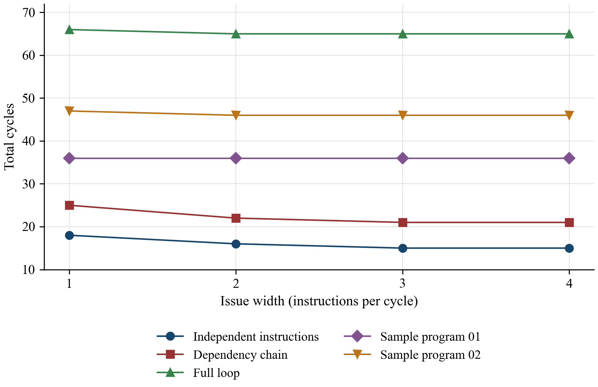

# Tomasulo Algorithm: Multi-Issue Implementation

**Tadesse Kebede Bahiru**  
**COSC 6385: Computer Architecture**

Repository: [github.com/TadesseK/processor-simulations](https://github.com/TadesseK/processor-simulations)

## 1. Implementation

I extended the supplied Python simulator to issue between one and four instructions in program order. `Issue width = N` is read from the input, and the default is one. Each instruction checks for available space in the reorder buffer (ROB) and its reservation station (RS) or load and store queue (LSQ) before allocation. A blocked instruction stops the issue bundle. Sources are captured before the destination is renamed, so later instructions in the same cycle see the correct dependency tags.

The simulator supports ADD, SUB, ADDI, ADD.D, SUB.D, MULT.D, LD, SD, BEQ, and BNE. It reads the hardware table, functional unit (FU) counts, execution latencies, memory latency, ROB capacity, register initialization, and memory initialization. All 32 integer and 32 floating-point (FP) registers are modeled, and R0 remains zero.

ISSUE is in order, but execution selects ready instructions out of order. Integer and effective-address units are unpipelined; FP units are pipelined. The original stage module names are retained. I replaced the starter's class-based records with typed entries and added a controller to advance the stages once per cycle. `STARTER_CHANGES.md` lists the changes to each module.

I widened ISSUE while keeping one common data bus (CDB), one commit per cycle, and one nonpipelined memory port. More load and store FUs allow more address calculations, but memory accesses still use the same port. The sample report uses wider WB and COMMIT stages, which explains some differences between its timing tables and the results here.

### State representation and preserved stage organization

I kept the supplied ISSUE, EX, MEM, WB, and COMMIT modules, replaced their record representation, and added `simulator.py` as the controller. The controller tracks each instruction's operands, results, and stage cycles.

The starter factories returned a newly created `namedtuple` class without constructing an instance, then used the class as a mutable record. Each call creates a fresh type, so the timing lists are not one global shared list. The defects are class objects used as entries, uninitialized tuple descriptors, and readiness inferred through Python type tests.

**Excerpt 1: starter ROB state. Exact excerpt from the supplied starter's `code/init.py`.**

```python
    temp = ROB_entry
    temp.issue = []
    temp.exe = []
    temp.mem = []
    temp.cdb = []
    temp.commit =[]
    return temp

```

The revised `ROBEntry` is an instance with separate timing lists created by `default_factory=list`. Operand objects explicitly hold a value, optional producer tag, and readiness cycle. Instructions are immutable; dynamic timing and results remain mutable. The excerpt below shows the per-entry lists.

**Excerpt 2: per-entry timing lists. Exact excerpt from `code/init.py`.**

```python
    issue: int
    exe: list = field(default_factory=list)
    mem: list = field(default_factory=list)
```

`seq` is a monotonically increasing dynamic tag, while actual ROB occupancy is bounded by `rob_entries`. Unique tags distinguish repeated executions of one PC and prevent an old result from satisfying a later instruction after a physical slot would have been reused.

### Hardware parsing and multiple-issue allocation

The starter read `code.in` and hardcoded initialization and hardware settings in `main.py`. `parse_input()` now reads the four hardware rows, register and memory values, ROB capacity, and issue width. It accepts case-insensitive instructions, optional commas, and all two-digit registers; the old fixed slices could misdecode their base operands.

**Excerpt 3: input setting recognition. Exact excerpt from `code/init.py`.**

```python
            setting = re.fullmatch(r"(rob\s+entries|issue\s+width)\s*=\s*([-+]?\d+)", line, re.I)
            if setting:
                setattr(config, "rob_entries" if setting[1].lower().startswith("rob") else "issue_width", int(setting[2]))
                continue

```

`Config` supplies `issue_width: int = 1`. Validation rejects nonpositive resources and widths above four. `--issue-width` can override the input for comparisons without editing it. 

**Excerpt 4: configuration validation. Exact excerpt from `code/init.py`.**

```python
    def validate(self):
        for key, value in vars(self).items():
            if not isinstance(value, int) or value < 1:
                raise ValueError(f"{key} must be a positive integer")
        if self.issue_width > 4:
            raise ValueError("Issue width must be between 1 and 4")
```

ISSUE now attempts up to the configured width sequentially. Fetch stops at the end of the buffer or during recovery. The next allocation needs both ROB space and space in its station or queue.

**Excerpt 5: issue-width loop. Exact excerpt from `code/issue.py`.**

```python
def issue(machine, cycle):
    if cycle < machine.fetch_resume:
        return
    for _ in range(machine.config.issue_width):
        if machine.pc == len(machine.instructions):
            break

```

**Excerpt 6: structural issue stop. Exact excerpt from `code/issue.py`.**

```python
        occupied = len(machine.lsq) if unit == "ls" else len(machine.rs[unit])
        if len(machine.rob) >= machine.config.rob_entries or occupied >= capacity:
            machine.stats["issue_stalls"] += 1
            break  # No younger instruction bypasses this structural hazard.
```

A blocked instruction ends the bundle; earlier successful allocations remain issued. A younger integer operation cannot bypass a blocked FP multiply during ISSUE. `issue_stalls` counts cycles with a failed next-allocation attempt, including partially filled bundles.

The allocation sequence reads sources before renaming the destination, then makes that rename visible to later issue slots. An instruction that reads and writes one register therefore captures its older source before becoming the current writer.

**Excerpt 7: source capture before renaming. Exact excerpt from `code/issue.py`.**

```python
        source1 = read_operand(machine, ins.src1)
        source2 = read_operand(machine, ins.src2)
        if ins.op == "addi":
            source2 = Operand(ins.immediate)
        entry = ROBEntry(machine.next_seq, machine.pc, ins, source1, source2, cycle)
        machine.next_seq += 1
        machine.by_seq[entry.seq] = entry
        machine.rob.append(entry)
        machine.history.append(entry)
        machine.stats["issued"] += 1
        if unit == "ls":
            machine.lsq.append(entry)
        else:
            machine.rs[unit].append(entry)
        if ins.dest is not None and ins.dest != "R0":
            machine.rat[ins.dest] = entry.seq
```

### Cycle controller and output records

The starter called stages forward and sometimes invoked EX again after dispatch. The reverse controller order below separates completion, broadcast, retirement, and new issue. Explicit operand readiness cycles also prevent consumers from executing in their producer's WB cycle.

**Excerpt 8: stage order. Exact excerpt from `code/simulator.py`.**

```python
            commit(self, self.cycle)
            wb(self, self.cycle)
            mem(self, self.cycle)
            exe(self, self.cycle)
            issue(self, self.cycle)
```

`print_status.py` prints dynamic ID, byte PC, instruction, all stage cycles, and committed or squashed status. Intervals are inclusive: 3–8 is six cycles. Dashes mean an unused or unreached stage, and interrupted intervals stop at squash. Text includes every register and nonzero memory; JSON retains recovery and forwarding details.

## 2. Correctness details

### Register renaming and stage timing

Each dynamic instruction has a unique producer tag. A consumer either captures a ready value or waits for that exact tag. Writeback wakes consumers without overwriting a newer mapping in the register alias table (RAT). Architectural registers change only at commit, and a matching RAT entry is cleared only when its current writer retires. This handles RAW, WAW, and WAR hazards, including dependencies inside an issue bundle.

A newly issued instruction starts EX no earlier than the next cycle. A consumer starts EX after its producer's WB cycle. A completed EX or MEM result writes back in a later cycle, and normal register instructions commit after WB. Integer and address units cannot accept a replacement during the cycle when their previous operation completes. Pipelined FP units can accept one operation per configured FU each cycle.

An operand with no tag has a captured value. `ready_cycle < cycle` prevents same-cycle WB consumption; initial values use -1. ISSUE can copy a live producer's already-written ROB value, avoiding a wait for a broadcast that will not happen again.

**Excerpt 9: operand readiness. Exact excerpt from `code/init.py`.**

```python
@dataclass
class Operand:
    value: int | float = 0
    tag: int | None = None
    ready_cycle: int = -1

    def available(self, cycle):
        return self.tag is None and self.ready_cycle < cycle
```

The old `wb.py` overwrote a destination's RAT value even if a younger writer had renamed it. The revised RAT identifies the latest live writer; an older broadcast updates its own ROB entry and tagged consumers while preserving the younger mapping.

In `renaming.txt` at width 4, an older multiply produces F2=12 at WB 14, while a younger addition produces F2=6 at WB 5. Its consumer correctly computes F8=9. Older operations retain their captured F4=3 even after a younger writer changes F4 to 8. Final F2=6, F4=8, F8=9, F10=12, F12=15, and F14=14 verify WAW and WAR behavior.

### Execution scheduling and functional-unit timing

The starter could invoke `fu_exe()` twice in one cycle and increment every active operation twice. The revised EX visit assigns one start and completion interval at dispatch, then processes completion once at its endpoint.

`_ready()` requires older issue and available operands. Loads and stores need their base for address calculation; store data can arrive later. ALU operations and branches require both operands. Younger independent work can therefore execute while an older instruction waits.

**Excerpt 10: execution readiness. Exact excerpt from `code/exe.py`.**

```python
def _ready(entry, cycle, unit):
    if entry.issue >= cycle:
        return False
    if unit == "ls":
        base = entry.operand1 if entry.op == "ld" else entry.operand2
        return base.available(cycle)
    return entry.operand1.available(cycle) and entry.operand2.available(cycle)
```

Ready candidates are ordered by dynamic age within each unit type. Integer and address capacity subtracts active tasks and tasks finishing this cycle. A pipelined FP FU instead supplies one new start each cycle, permitting overlapping operations.

**Excerpt 11: execution interval and dispatch. Exact excerpt from `code/exe.py`.**

```python
        for e in candidates[:available]:
            if e.squashed:
                continue
            e.exe[:] = [cycle, cycle + latency - 1]
            task = Task(e, cycle, cycle + latency - 1, unit)
            if unit != "ls":
                machine.rs[unit].remove(e)
            if latency == 1:
                _finish(machine, task, cycle)
            else:
                machine.tasks.append(task)
```

EX records `[start, start + latency - 1]`. One-cycle tasks finish immediately; longer tasks remain active. Stations are released at dispatch, following the starter, while tasks retain their sources and tags. This also fixes multi-cycle address calculation: the old implementation advanced its counter only once.

At width 4, `out_of_order.txt` executes an independent integer operation in cycle 2 and broadcasts it in cycle 3. An independent FP subtraction broadcasts in cycle 5. The older multiply runs 2–15, and its dependent addition waits until 17–19. Commits remain in program order at 17, 21, 22, and 23.

### Single-CDB writeback and in-order commitment

Unlike the sample's widened WB loop, `wb()` selects one eligible result per cycle. Eligibility requires earlier completion; arbitration orders by completion cycle, then dynamic age. The excerpt updates the selected producer's ROB entry.

**Excerpt 12: one selected broadcast. Exact excerpt from `code/wb.py`.**

```python
    result = min(eligible, key=lambda r: (r.completed, r.entry.seq))
    machine.results.remove(result)
    entry = result.entry
    entry.value = result.value
    entry.wb = cycle
    entry.ready = True
```

The broadcast wakes all operands with that exact tag, including store data and load or store bases. Their readiness cycle becomes the current cycle. No second result is selected, regardless of issue width.

**Excerpt 13: wakeup by producer tag. Exact excerpt from `code/wb.py`.**

```python
    for waiting in machine.rob:
        for operand in (waiting.operand1, waiting.operand2):
            if operand.tag == entry.seq:
                operand.tag = None
                operand.value = result.value
                operand.ready_cycle = cycle
```

The old commit path could change registers while reporting `cycle+1` and sometimes retire an extra entry after a store. The revised function examines one ROB head: register instructions require earlier WB, branches require resolved EX, and stores require completed memory. Younger ready entries wait.

Commit clears a RAT mapping only if it still points to the retiring writer. An older writer updates architectural state in order without deleting a younger rename. The actual commit cycle is recorded, and one entry is removed.

**Excerpt 14: RAT clearing and retirement. Exact excerpt from `code/commit.py`.**

```python
        if machine.rat.get(e.dest) == e.seq:
            del machine.rat[e.dest]
    e.commit = cycle
    machine.rob.pop(0)
    machine.stats["committed"] += 1
```

The later tables show these limits directly: simultaneous completions broadcast on consecutive cycles, and early integer results wait behind older FP instructions to retire.

### Branch prediction and recovery

The predictor stores one direction bit for each static branch and uses an eight-entry tagged branch target buffer (BTB). The index is the low three bits of the word PC. Prediction occurs during ISSUE, and a branch resolves at the end of EX.

If the predicted next PC differs from the actual next PC in cycle n, the simulator squashes every younger ROB entry and its RS, LSQ, execution, result, and memory state. It rebuilds the RAT from committed state and surviving in-flight writers. Cycle n+1 is the recovery bubble; correct fetch starts at n+2. Branches have no WB result because they do not write a register.

For example, `branch_squash.txt` at width 4 resolves BEQ at cycle 5. The wrong-path register update and store are squashed. The target is reissued at cycle 7, commits at cycle 13, and leaves R3=7 and Mem[16]=1.

The starter stopped fetch on BNE with `PC.valid = 0`, without prediction or recovery. BEQ and BNE now enter integer stations, record their issue-time predicted next PC, and resolve at EX completion. Word offsets are the default.

Unseen branches predict not taken. Taken predictions require a matching tagged BTB entry, so colliding indices cannot substitute another PC's target. Resolution updates the direction and target, then recovers if the predicted next PC differed.

**Excerpt 15: predictor update and mismatch recovery. Exact excerpt from `code/exe.py`.**

```python
        machine.predictor[e.pc] = taken
        machine.btb[e.pc & 7] = (e.pc, target)
        if actual != e.predicted_next:
            machine.stats["mispredictions"] += 1
            machine.squash_after(e.seq, actual, cycle)
```

Recovery removes younger ROB, RS, LSQ, FU, and result state and cancels wrong-path memory work. RAT reconstruction retains the youngest surviving writer, including older pending producers that would be lost by clearing the whole table.

**Excerpt 16: RAT reconstruction and fetch restart. Exact excerpt from `code/simulator.py`.**

```python
        self.rat = {}
        for entry in self.rob:
            if entry.dest is not None and entry.dest != "R0":
                self.rat[entry.dest] = entry.seq
        self.pc = next_pc
        self.recovery_cycle = cycle + 1
        self.fetch_resume = cycle + 2
```

In `branch_rat_recovery.txt` at width 4, a cycle-4 branch squash removes a younger F2 writer while an older multiply survives. Fetch resumes in cycle 6. The target waits for that multiply's WB at 18, executes 19–21, and commits F8=15 at 23.

Invalid addresses and targets are reported when the instruction reaches commit. If an older branch squashes the instruction first, the error is discarded. The tests check both cases. Branch prediction state can change during speculative execution; registers and memory change only when instructions commit.

### Loads, stores, and replay

Stores calculate addresses in EX and remain in the LSQ until retirement. Only a store at the ROB head starts a memory write. The write completes after the configured memory latency, and its completion is its commit cycle. Stores have no CDB or WB entry.

A load searches all older stores and selects the newest known address match. It waits if that store's data is unavailable; otherwise forwarding takes one MEM cycle. Loads can access memory while older store addresses remain unknown. If a known match exists, its value can be forwarded provisionally while another older store is unresolved. A subsequently resolved newer matching store invalidates that result. The oldest affected load and all younger instructions are squashed and replayed. Loads that receive data leave the LSQ immediately.

In `memory_replay.txt`, an early load initially reads the old value at address 16 while an older store waits for its base register. When the store resolves to address 16, the load and dependent addition are replayed. The committed result is F4=9, F6=18, and Mem[16]=9 at every issue width.

The starter stopped its search at the nearest store even if it did not match. It also dequeued stores prematurely, misspelled a tag field, and tested a function object instead of calling it. I replaced those paths with dynamic-age matching and ROB-head store retirement.

The search covers all older queued stores and chooses the newest known address match. A nonmatching nearest store cannot hide an older match, and a younger store is never a forwarding source.

**Excerpt 17: newest matching store selection. Exact excerpt from `code/mem.py`.**

```python
        older = [s for s in machine.lsq if s.op == "sd" and s.seq < e.seq]
        matching = [s for s in older if s.address == e.address]
        source = max(matching, key=lambda s: s.seq) if matching else None
```

**Excerpt 18: one-cycle forwarding. Exact excerpt from `code/mem.py`.**

```python
        if source is not None:
            if not source.operand1.available(cycle):
                continue
            e.mem[:] = [cycle, cycle]
            e.forwarded_from = source.seq
            machine.stats["forwarded_loads"] += 1
            finish_load(machine, e, source.operand1.value, cycle)
            break

```

Forwarding records one MEM cycle and releases the load's LSQ entry; its ROB entry waits for WB and commit. The forwarding path does not consume the physical memory port. At most one load starts MEM per cycle, while ordinary accesses hold the port for their full latency.

`check_memory_violation()` runs when a store's address resolves. It finds younger loads that have started MEM at the same address, except those already forwarded from a newer applicable older store. Recovery begins at the oldest invalid load.

**Excerpt 19: replay from the oldest violating load. Exact excerpt from `code/simulator.py`.**

```python
        if violating:
            first = min(violating, key=lambda e: e.seq)
            self.stats["replays"] += 1
            self.squash_after(first.seq, first.pc, cycle, include=True, reason="memory")
```

`include=True` squashes the load itself and its younger consumers. Recovery removes incorrect pending results, rebuilds surviving renames, and restarts at that load's PC. In-order store retirement ensures no younger store has already committed past the unresolved older store.

If a known match precedes an unknown store that later proves nonmatching, reading old memory would wrongly lose the known value. Provisional forwarding avoids that error. Independent checks measured F3=9 with zero replays for the nonalias case and F3=7 with one replay for the superseding alias.

A store waits for its address, data, ROB-head position, and a free memory port. At the boundary below it writes memory and leaves the LSQ. Its WB is blank, and COMMIT equals its MEM endpoint.

**Excerpt 20: store completion at commit. Exact excerpt from `code/commit.py`.**

```python
        if e.mem[-1] != cycle:
            return
        machine.memory[e.address] = e.operand1.value
        machine.memory_task = None
        machine.memory_free_after = cycle
        machine.lsq.remove(e)
```

A wrong-path store may calculate an address before an older branch resolves, but it cannot write memory before that branch retires. A squash discards its captured address and data.

## 3. Input handling

The assignment defines branch immediates as word displacements: `PC + 4 + (offset << 2)`. The starter instead divides its immediate by four and supplies `Bne R1 R0 -12`. I preserved the exact original files under `test_cases/legacy/` and added an explicit `--branch-offset-mode bytes` option. The corresponding word-offset fixture changes only `-12` to `-3`. Both branch from byte PC 28 to byte PC 20, so the original benchmark repeats the pointer updates rather than the full load and store body. `full_loop.txt` separately uses `-8` to repeat the full body.

The instruction-only `code.in` has no initialization. Running it with all-zero registers would not terminate, so the complete provided `test_case.txt` is the benchmark. The handout's short input example also repeats indefinitely because its backward BNE never changes R2 or R3.

I kept the starter's memory array: each address from 0 to 255 holds one numeric value. The parser accepts unaligned addresses, including address 18 in the handout's example. FP operations use Python floating-point numbers.

The parser rejects invalid register numbers, issue widths, and resource counts.

## 4. Tests and measured results

The automated suite contains 30 passing test methods. It checks 25 complete fixtures at all four widths against a separate sequential ISA interpreter, comparing every integer register, FP register, memory location, and committed dynamic PC. It also checks 24 seeded 36-instruction mixed-program runs and directed timing and recovery cases.

The tests cover within-bundle RAW dependencies; WAW and WAR renaming; R0; out-of-order execution and in-order commit; one CDB; configurable pipelined and unpipelined FUs; multi-cycle address calculation; single-port memory; newest-store forwarding; unavailable store data; unknown-store alias and nonalias cases; branch prediction, BTB collisions, RAT recovery, and fetch at n+2; small ROB and LSQ capacities; case-insensitive syntax; two-digit register names; and original fixture checksums. Additional regressions cover provisional forwarding past an unknown nonmatching store and deferred faults from speculative invalid loads or branch targets.

`run_experiments.py` produced 104 completed width runs: 25 finite fixtures at widths 1–4, plus the exact legacy complete fixture at widths 1–4 in byte-offset mode. Every run matched the independent interpreter. Text tables, full JSON traces, configuration and input hashes, recovery events, and final states are included under `results/`.

I also ran a second verification script on 250 generated programs, each containing 35 instructions, with varied hardware settings at all four widths. All 1,000 runs matched its sequential interpreter. Four additional cases checked forwarding and errors on speculative paths. The script and output are in `review/`.

The comparison script reads assembly separately and checks both the final state and committed PC sequence. The timing tests check resource occupancy, stage boundaries, one broadcast and one commit per cycle, and correct fetch at n+2.

The logs record 30 passing tests, 104 matched width runs, and 1,000 matched generated-program runs with seed 92731. The generated programs use forward branches; separate test programs check loops.

**Table 1. Total cycles by issue width.**

| Test case | Width 1 | Width 2 | Width 3 | Width 4 |
| --- | ---: | ---: | ---: | ---: |
| branch btb alias | 41 | 36 | 35 | 35 |
| branch conditions | 13 | 13 | 13 | 13 |
| branch loop | 20 | 19 | 19 | 19 |
| branch rat recovery | 23 | 23 | 23 | 23 |
| branch skip to end | 3 | 3 | 3 | 3 |
| branch squash | 13 | 13 | 13 | 13 |
| dependencies | 25 | 22 | 21 | 21 |
| forward past nonmatching store | 32 | 32 | 32 | 32 |
| full loop | 66 | 65 | 65 | 65 |
| functional units | 27 | 27 | 27 | 27 |
| head of line | 17 | 17 | 17 | 17 |
| independent | 18 | 16 | 15 | 15 |
| memory nonalias | 17 | 17 | 17 | 17 |
| memory replay | 24 | 24 | 24 | 24 |
| memory serial | 28 | 28 | 28 | 28 |
| memory waiting store data | 22 | 22 | 22 | 22 |
| mixed case | 33 | 33 | 33 | 33 |
| out of order | 23 | 23 | 23 | 23 |
| renaming | 24 | 22 | 22 | 22 |
| sample report 01 | 36 | 36 | 36 | 36 |
| sample report 02 | 47 | 46 | 46 | 46 |
| store forwarding | 43 | 43 | 43 | 43 |
| test case words | 45 | 45 | 45 | 45 |
| tiny structures | 35 | 35 | 35 | 35 |
| zero register | 13 | 13 | 14 | 14 |
| legacy test case | 45 | 45 | 45 | 45 |

Larger issue width gives modest improvements when instruction issue is limiting. For independent instructions, total time falls from 18 to 15 cycles, a speedup of 18/15=1.20. The dependency fixture falls from 25 to 21 cycles. Several cases remain unchanged because execution dependencies, memory latency, or the single commit path dominate. 

The sample report's first program takes 36 cycles at all widths here. Its second program takes 47 cycles at width 1 and 46 cycles at widths 2–4. The sample uses different writeback, commit, and memory settings, so some stage cycles differ. Both programs produced the same final register and memory values as the independent interpreter.



**Figure 1. Measured total cycles under issue widths 1–4 for five representative fixtures.**

The points come directly from `results/width_results.csv`. Earlier issue lowers independent and dependency totals. The first sample stays flat; the second sample and full loop save one cycle. The timing tables below show which dependencies and occupied units account for these totals.

### Worked sample case 01: one FU of each type

`test_cases/sample_report_01.txt` reproduces the first sample's program and configuration. Only issue width changes across runs. The ROB has 64 entries; the rows below give station or queue capacity, inclusive EX and MEM latencies, and FU counts.

**Table 2. Hardware configuration for sample case 01.**

| Unit | RS or LSQ entries | EX cycles | MEM cycles | FUs |
| --- | ---: | ---: | ---: | ---: |
| Integer adder | 4 | 1 | — | 1 |
| FP adder | 4 | 3 | — | 1 |
| FP multiplier | 4 | 5 | — | 1 |
| Effective-address unit | 4 | 1 | 6 | 1 |

The initial values are R1=12, R2=32, and F20=3.0. Nonzero memory is Mem[4]=3, Mem[8]=2, Mem[12]=1, Mem[24]=6, Mem[28]=5, and Mem[32]=4. All other values, including F0, F1, F2, F3, F4, and Mem[20], start at zero. The full instruction program is copied below from the included fixture.

```text
Ld F1 0(R1)
Mult.d F2 F1 F0
Add.d F3 F3 F2
Mult.d F2 F1 F1
Add.d F4 F2 F4
Addi R1 R1 8
Ld F1 0(R1)
Mult.d F2 F1 F0
Add.d F3 F3 F2
Mult.d F2 F1 F1
Add.d F4 F2 F4
Addi R1 R1 8
Ld F1 0(R1)
Mult.d F2 F1 F0
Add.d F3 F3 F2
Mult.d F2 F1 F1
Add.d F4 F2 F4
```

The program reads addresses 12, 20, and 28 because the two ADDI instructions each increase R1 by eight. Their values are 1, 0, and 5. Multiplying each by F0 produces zero, so the F3 accumulation stays zero. The other multiplication squares each loaded value, and F4 accumulates 1+0+25=26. The last load and square leave F1=5 and F2=25. R1 ends at 28; R2=32 and F20=3 are unchanged. There are no stores, so all initialized memory values remain unchanged and every other memory location remains zero.

The four tables contain all 17 dynamic rows from the saved JSON. IDs distinguish repeated instructions. Every row committed, without branches, squashes, or replays. Intervals are inclusive; a dash marks unused MEM.

**Table 3. Sample case 01 instruction status, issue width 1.**

| ID | Instruction | ISSUE | EX | MEM | WB | COMMIT |
| ---: | --- | ---: | --- | --- | ---: | ---: |
| 0 | Ld F1 0(R1) | 1 | 2 | 3–8 | 9 | 10 |
| 1 | Mult.d F2 F1 F0 | 2 | 10–14 | — | 15 | 16 |
| 2 | Add.d F3 F3 F2 | 3 | 16–18 | — | 19 | 20 |
| 3 | Mult.d F2 F1 F1 | 4 | 11–15 | — | 16 | 21 |
| 4 | Add.d F4 F2 F4 | 5 | 17–19 | — | 20 | 22 |
| 5 | Addi R1 R1 8 | 6 | 7 | — | 8 | 23 |
| 6 | Ld F1 0(R1) | 7 | 9 | 10–15 | 17 | 24 |
| 7 | Mult.d F2 F1 F0 | 8 | 18–22 | — | 23 | 25 |
| 8 | Add.d F3 F3 F2 | 9 | 24–26 | — | 27 | 28 |
| 9 | Mult.d F2 F1 F1 | 10 | 19–23 | — | 24 | 29 |
| 10 | Add.d F4 F2 F4 | 11 | 25–27 | — | 28 | 30 |
| 11 | Addi R1 R1 8 | 12 | 13 | — | 14 | 31 |
| 12 | Ld F1 0(R1) | 13 | 15 | 16–21 | 22 | 32 |
| 13 | Mult.d F2 F1 F0 | 14 | 23–27 | — | 29 | 33 |
| 14 | Add.d F3 F3 F2 | 16 | 30–32 | — | 33 | 34 |
| 15 | Mult.d F2 F1 F1 | 17 | 24–28 | — | 30 | 35 |
| 16 | Add.d F4 F2 F4 | 18 | 31–33 | — | 34 | 36 |

**Table 4. Sample case 01 instruction status, issue width 2.**

| ID | Instruction | ISSUE | EX | MEM | WB | COMMIT |
| ---: | --- | ---: | --- | --- | ---: | ---: |
| 0 | Ld F1 0(R1) | 1 | 2 | 3–8 | 9 | 10 |
| 1 | Mult.d F2 F1 F0 | 1 | 10–14 | — | 15 | 16 |
| 2 | Add.d F3 F3 F2 | 2 | 16–18 | — | 19 | 20 |
| 3 | Mult.d F2 F1 F1 | 2 | 11–15 | — | 17 | 21 |
| 4 | Add.d F4 F2 F4 | 3 | 18–20 | — | 21 | 22 |
| 5 | Addi R1 R1 8 | 3 | 4 | — | 5 | 23 |
| 6 | Ld F1 0(R1) | 4 | 6 | 9–14 | 16 | 24 |
| 7 | Mult.d F2 F1 F0 | 4 | 17–21 | — | 23 | 25 |
| 8 | Add.d F3 F3 F2 | 5 | 24–26 | — | 27 | 28 |
| 9 | Mult.d F2 F1 F1 | 5 | 18–22 | — | 24 | 29 |
| 10 | Add.d F4 F2 F4 | 6 | 25–27 | — | 28 | 30 |
| 11 | Addi R1 R1 8 | 6 | 7 | — | 8 | 31 |
| 12 | Ld F1 0(R1) | 7 | 9 | 15–20 | 22 | 32 |
| 13 | Mult.d F2 F1 F0 | 10 | 23–27 | — | 29 | 33 |
| 14 | Add.d F3 F3 F2 | 16 | 30–32 | — | 33 | 34 |
| 15 | Mult.d F2 F1 F1 | 16 | 24–28 | — | 30 | 35 |
| 16 | Add.d F4 F2 F4 | 18 | 31–33 | — | 34 | 36 |

**Table 5. Sample case 01 instruction status, issue width 3.**

| ID | Instruction | ISSUE | EX | MEM | WB | COMMIT |
| ---: | --- | ---: | --- | --- | ---: | ---: |
| 0 | Ld F1 0(R1) | 1 | 2 | 3–8 | 9 | 10 |
| 1 | Mult.d F2 F1 F0 | 1 | 10–14 | — | 15 | 16 |
| 2 | Add.d F3 F3 F2 | 1 | 16–18 | — | 19 | 20 |
| 3 | Mult.d F2 F1 F1 | 2 | 11–15 | — | 17 | 21 |
| 4 | Add.d F4 F2 F4 | 2 | 18–20 | — | 21 | 22 |
| 5 | Addi R1 R1 8 | 2 | 3 | — | 4 | 23 |
| 6 | Ld F1 0(R1) | 3 | 5 | 9–14 | 16 | 24 |
| 7 | Mult.d F2 F1 F0 | 3 | 17–21 | — | 23 | 25 |
| 8 | Add.d F3 F3 F2 | 3 | 24–26 | — | 27 | 28 |
| 9 | Mult.d F2 F1 F1 | 4 | 18–22 | — | 24 | 29 |
| 10 | Add.d F4 F2 F4 | 4 | 25–27 | — | 28 | 30 |
| 11 | Addi R1 R1 8 | 4 | 5 | — | 6 | 31 |
| 12 | Ld F1 0(R1) | 5 | 7 | 15–20 | 22 | 32 |
| 13 | Mult.d F2 F1 F0 | 10 | 23–27 | — | 29 | 33 |
| 14 | Add.d F3 F3 F2 | 16 | 30–32 | — | 33 | 34 |
| 15 | Mult.d F2 F1 F1 | 16 | 24–28 | — | 30 | 35 |
| 16 | Add.d F4 F2 F4 | 18 | 31–33 | — | 34 | 36 |

**Table 6. Sample case 01 instruction status, issue width 4.**

| ID | Instruction | ISSUE | EX | MEM | WB | COMMIT |
| ---: | --- | ---: | --- | --- | ---: | ---: |
| 0 | Ld F1 0(R1) | 1 | 2 | 3–8 | 9 | 10 |
| 1 | Mult.d F2 F1 F0 | 1 | 10–14 | — | 15 | 16 |
| 2 | Add.d F3 F3 F2 | 1 | 16–18 | — | 19 | 20 |
| 3 | Mult.d F2 F1 F1 | 1 | 11–15 | — | 17 | 21 |
| 4 | Add.d F4 F2 F4 | 2 | 18–20 | — | 21 | 22 |
| 5 | Addi R1 R1 8 | 2 | 3 | — | 4 | 23 |
| 6 | Ld F1 0(R1) | 2 | 5 | 9–14 | 16 | 24 |
| 7 | Mult.d F2 F1 F0 | 2 | 17–21 | — | 23 | 25 |
| 8 | Add.d F3 F3 F2 | 3 | 24–26 | — | 27 | 28 |
| 9 | Mult.d F2 F1 F1 | 3 | 18–22 | — | 24 | 29 |
| 10 | Add.d F4 F2 F4 | 3 | 25–27 | — | 28 | 30 |
| 11 | Addi R1 R1 8 | 3 | 5 | — | 6 | 31 |
| 12 | Ld F1 0(R1) | 4 | 7 | 15–20 | 22 | 32 |
| 13 | Mult.d F2 F1 F0 | 10 | 23–27 | — | 29 | 33 |
| 14 | Add.d F3 F3 F2 | 16 | 30–32 | — | 33 | 34 |
| 15 | Mult.d F2 F1 F1 | 16 | 24–28 | — | 30 | 35 |
| 16 | Add.d F4 F2 F4 | 18 | 31–33 | — | 34 | 36 |

At width 1, the first load issues in cycle 1, calculates address 12 in cycle 2, occupies memory in cycles 3–8, writes back in cycle 9, and commits in cycle 10. Its dependent multiplication begins in cycle 10 and runs for five cycles, through cycle 14. The next multiplication begins in cycle 11 while that first one remains active, demonstrating the multiplier pipeline. The dependent F3 addition cannot start before cycle 16 because its multiplication broadcasts in cycle 15.

Wider ISSUE moves pointer updates earlier. At width 4, the first ADDI issues in cycle 2, executes in cycle 3, and writes back in cycle 4. The second load can calculate its address in cycle 5, but it cannot use the memory port while the first load occupies cycles 3–8. It therefore starts MEM in cycle 9. The third load follows in cycles 15–20. This is address calculation ahead of memory service, not overlapping memory accesses.

At widths 2–4, the second load finishes in cycle 14 alongside the first zero-product multiplication. The older multiply takes WB 15, the load takes WB 16, and the first square waits for WB 17. Later, the third load and first F4 addition both finish in cycle 20; the older addition takes WB 21, leaving the load at WB 22. Width 1 also broadcasts that final load at 22. Thus the final F3 and F4 additions remain at EX 30–32 and 31–33, with WB 33 and 34 and final commit 36.

All widths finish in 36 cycles. Earlier issue does not shorten the final dependent accumulation and retirement path. Structural-stall counts are 1, 10, 13, and 14: wider issue reaches full stations sooner. Each run still issues and commits 17 instructions.

### Worked sample case 02: multiple FP and address units

The second sample uses a 128-entry ROB, two FP adders, two FP multipliers, and two effective-address units. Its memory port remains single and nonpipelined. The initial register and memory values are the same as in case 01; the full configuration and program are preserved in `test_cases/sample_report_02.txt`.

**Table 7. Hardware configuration for sample case 02.**

| Unit | RS or LSQ entries | EX cycles | MEM cycles | FUs |
| --- | ---: | ---: | ---: | ---: |
| Integer adder | 4 | 1 | — | 1 |
| FP adder | 3 | 3 | — | 2 |
| FP multiplier | 2 | 15 | — | 2 |
| Effective-address unit | 4 | 1 | 5 | 2 |

```text
Ld F1 0(R1)
Mult.d F2 F1 F0
Add.d F3 F3 F2
Mult.d F2 F1 F1
Ld F1 0(R1)
Addi R1 R1 4
Add.d F4 F2 F4
Addi R1 R1 8
Ld F1 0(R1)
Mult.d F2 F1 F0
Add.d F3 F3 F2
Mult.d F2 F1 F1
Ld F1 0(R1)
Mult.d F2 F1 F0
Add.d F3 F3 F2
Mult.d F2 F1 F1
Add.d F4 F2 F4
```

The first two loads both capture the original R1=12. The pointer updates then add four and eight, leaving R1=24, and the remaining two loads read address 24. Their values are 1, 1, 6, and 6. The first addition to F4 uses the first square, 1, and the final addition uses the last square, 36. Thus F4=37, F1=6, and the latest F2=36. F3 remains zero because its multiplication stream uses F0=0. R2=32 and F20=3 remain unchanged, and all memory stays at its initialized values.

**Table 8. Sample case 02 instruction status, issue width 1.**

| ID | Instruction | ISSUE | EX | MEM | WB | COMMIT |
| ---: | --- | ---: | --- | --- | ---: | ---: |
| 0 | Ld F1 0(R1) | 1 | 2 | 3–7 | 8 | 9 |
| 1 | Mult.d F2 F1 F0 | 2 | 9–23 | — | 24 | 25 |
| 2 | Add.d F3 F3 F2 | 3 | 25–27 | — | 28 | 29 |
| 3 | Mult.d F2 F1 F1 | 4 | 9–23 | — | 25 | 30 |
| 4 | Ld F1 0(R1) | 5 | 6 | 8–12 | 13 | 31 |
| 5 | Addi R1 R1 4 | 6 | 7 | — | 9 | 32 |
| 6 | Add.d F4 F2 F4 | 7 | 26–28 | — | 29 | 33 |
| 7 | Addi R1 R1 8 | 8 | 10 | — | 11 | 34 |
| 8 | Ld F1 0(R1) | 9 | 12 | 13–17 | 18 | 35 |
| 9 | Mult.d F2 F1 F0 | 10 | 19–33 | — | 34 | 36 |
| 10 | Add.d F3 F3 F2 | 11 | 35–37 | — | 38 | 39 |
| 11 | Mult.d F2 F1 F1 | 12 | 19–33 | — | 35 | 40 |
| 12 | Ld F1 0(R1) | 13 | 14 | 18–22 | 23 | 41 |
| 13 | Mult.d F2 F1 F0 | 19 | 24–38 | — | 39 | 42 |
| 14 | Add.d F3 F3 F2 | 25 | 40–42 | — | 43 | 44 |
| 15 | Mult.d F2 F1 F1 | 26 | 27–41 | — | 42 | 45 |
| 16 | Add.d F4 F2 F4 | 27 | 43–45 | — | 46 | 47 |

**Table 9. Sample case 02 instruction status, issue width 2.**

| ID | Instruction | ISSUE | EX | MEM | WB | COMMIT |
| ---: | --- | ---: | --- | --- | ---: | ---: |
| 0 | Ld F1 0(R1) | 1 | 2 | 3–7 | 8 | 9 |
| 1 | Mult.d F2 F1 F0 | 1 | 9–23 | — | 24 | 25 |
| 2 | Add.d F3 F3 F2 | 2 | 25–27 | — | 28 | 29 |
| 3 | Mult.d F2 F1 F1 | 2 | 9–23 | — | 25 | 30 |
| 4 | Ld F1 0(R1) | 3 | 4 | 8–12 | 13 | 31 |
| 5 | Addi R1 R1 4 | 3 | 4 | — | 5 | 32 |
| 6 | Add.d F4 F2 F4 | 4 | 26–28 | — | 29 | 33 |
| 7 | Addi R1 R1 8 | 4 | 6 | — | 7 | 34 |
| 8 | Ld F1 0(R1) | 5 | 8 | 13–17 | 18 | 35 |
| 9 | Mult.d F2 F1 F0 | 9 | 19–33 | — | 34 | 36 |
| 10 | Add.d F3 F3 F2 | 9 | 35–37 | — | 38 | 39 |
| 11 | Mult.d F2 F1 F1 | 10 | 19–33 | — | 35 | 40 |
| 12 | Ld F1 0(R1) | 10 | 11 | 18–22 | 23 | 41 |
| 13 | Mult.d F2 F1 F0 | 19 | 24–38 | — | 39 | 42 |
| 14 | Add.d F3 F3 F2 | 25 | 40–42 | — | 43 | 44 |
| 15 | Mult.d F2 F1 F1 | 25 | 26–40 | — | 41 | 45 |
| 16 | Add.d F4 F2 F4 | 26 | 42–44 | — | 45 | 46 |

**Table 10. Sample case 02 instruction status, issue width 3.**

| ID | Instruction | ISSUE | EX | MEM | WB | COMMIT |
| ---: | --- | ---: | --- | --- | ---: | ---: |
| 0 | Ld F1 0(R1) | 1 | 2 | 3–7 | 8 | 9 |
| 1 | Mult.d F2 F1 F0 | 1 | 9–23 | — | 24 | 25 |
| 2 | Add.d F3 F3 F2 | 1 | 25–27 | — | 28 | 29 |
| 3 | Mult.d F2 F1 F1 | 2 | 9–23 | — | 25 | 30 |
| 4 | Ld F1 0(R1) | 2 | 3 | 8–12 | 13 | 31 |
| 5 | Addi R1 R1 4 | 2 | 3 | — | 4 | 32 |
| 6 | Add.d F4 F2 F4 | 3 | 26–28 | — | 29 | 33 |
| 7 | Addi R1 R1 8 | 3 | 5 | — | 6 | 34 |
| 8 | Ld F1 0(R1) | 3 | 7 | 13–17 | 18 | 35 |
| 9 | Mult.d F2 F1 F0 | 9 | 19–33 | — | 34 | 36 |
| 10 | Add.d F3 F3 F2 | 9 | 35–37 | — | 38 | 39 |
| 11 | Mult.d F2 F1 F1 | 9 | 19–33 | — | 35 | 40 |
| 12 | Ld F1 0(R1) | 10 | 11 | 18–22 | 23 | 41 |
| 13 | Mult.d F2 F1 F0 | 19 | 24–38 | — | 39 | 42 |
| 14 | Add.d F3 F3 F2 | 25 | 40–42 | — | 43 | 44 |
| 15 | Mult.d F2 F1 F1 | 25 | 26–40 | — | 41 | 45 |
| 16 | Add.d F4 F2 F4 | 26 | 42–44 | — | 45 | 46 |

**Table 11. Sample case 02 instruction status, issue width 4.**

| ID | Instruction | ISSUE | EX | MEM | WB | COMMIT |
| ---: | --- | ---: | --- | --- | ---: | ---: |
| 0 | Ld F1 0(R1) | 1 | 2 | 3–7 | 8 | 9 |
| 1 | Mult.d F2 F1 F0 | 1 | 9–23 | — | 24 | 25 |
| 2 | Add.d F3 F3 F2 | 1 | 25–27 | — | 28 | 29 |
| 3 | Mult.d F2 F1 F1 | 1 | 9–23 | — | 25 | 30 |
| 4 | Ld F1 0(R1) | 2 | 3 | 8–12 | 13 | 31 |
| 5 | Addi R1 R1 4 | 2 | 3 | — | 4 | 32 |
| 6 | Add.d F4 F2 F4 | 2 | 26–28 | — | 29 | 33 |
| 7 | Addi R1 R1 8 | 2 | 5 | — | 6 | 34 |
| 8 | Ld F1 0(R1) | 3 | 7 | 13–17 | 18 | 35 |
| 9 | Mult.d F2 F1 F0 | 9 | 19–33 | — | 34 | 36 |
| 10 | Add.d F3 F3 F2 | 9 | 35–37 | — | 38 | 39 |
| 11 | Mult.d F2 F1 F1 | 9 | 19–33 | — | 35 | 40 |
| 12 | Ld F1 0(R1) | 9 | 10 | 18–22 | 23 | 41 |
| 13 | Mult.d F2 F1 F0 | 19 | 24–38 | — | 39 | 42 |
| 14 | Add.d F3 F3 F2 | 25 | 40–42 | — | 43 | 44 |
| 15 | Mult.d F2 F1 F1 | 25 | 26–40 | — | 41 | 45 |
| 16 | Add.d F4 F2 F4 | 26 | 42–44 | — | 45 | 46 |

The first load uses memory in cycles 3–7 at every width and broadcasts in cycle 8. With two FP multipliers, both early multiplications can start in cycle 9 and finish in cycle 23. The single CDB still broadcasts them in cycles 24 and 25. Their consumers therefore begin in cycles 25 and 26 respectively; two available FP adders do not erase the difference in operand arrival times.

The two address units let ready load addresses be calculated earlier, but the four physical memory intervals are identical across the four runs: 3–7, 8–12, 13–17, and 18–22. For example, at width 4 the second load calculates its address in cycle 3, while its memory access waits until cycle 8. Its five MEM cycles do not overlap the first load. The same distinction explains why additional load and store FUs cannot be interpreted as additional memory ports.

A remaining difference occurs near the end. At width 1, the last square issues in cycle 26, executes in cycles 27–41, and writes back in cycle 42. The final F4 addition executes in cycles 43–45, broadcasts in cycle 46, and commits in cycle 47. At widths 2–4, that square issues in cycle 25, executes in cycles 26–40, and broadcasts in cycle 41. The final addition shifts to cycles 42–44, WB cycle 45, and commit cycle 46.

The final totals are 47, 46, 46, and 46. Width above two cannot shorten this tail further. Stall counts are 10, 18, 21, and 22, entirely from FP station capacity. Each run issues and commits 17 instructions and matches the oracle.

**Table 12. Selected final states.**

| Test case | Expected and measured final state at every width |
| --- | --- |
| Provided and legacy fixtures | R1=0, R2=20, F2=1, F4=3, F6=7, F20=2; Mem[32]=7 |
| Full load and store loop | R1=0, R2=20, F2=3, F4=9, F6=15, F20=6; Mem[32]=7, Mem[28]=11, Mem[24]=15 |
| Sample report 01 | R1=28, R2=32, F1=5, F2=25, F3=0, F4=26; initialized memory unchanged |
| Sample report 02 | R1=24, R2=32, F1=6, F2=36, F3=0, F4=37; initialized memory unchanged |
| Memory replay | R1=16, F2=9, F4=9, F6=18; Mem[16]=9; one replay |
| Branch loop | R1=0, R2=3, R3=13; two mispredictions, covering initial taken learning and loop exit |

For the full load and store loop, the three stores compute 1×3+4=7, 2×3+5=11, and 3×3+6=15. This provides a direct check of both the arithmetic and the memory addresses. In sample report 01, the loads read values 1, 0, and 5, so F4=1²+0²+5²=26. In sample report 02, the two values contributing to F4 are 1² and 6², giving 37.

**Table 13. Memory replay status at issue width 4.**

| ID | Instruction | ISSUE | EX | MEM | WB | COMMIT | Status |
| ---: | --- | ---: | --- | --- | --- | --- | --- |
| 0 | Addi R1,R0,16 | 1 | 2–11 | — | 12 | 13 | Committed |
| 1 | Sd F2,0(R1) | 1 | 13 | 14–15 | — | 15 | Committed |
| 2 | Ld F4,16(R0) | 1 | 2 | 3–4 | 5 | — | Squashed |
| 3 | Add.d F6,F4,F2 | 1 | 6–8 | — | 9 | — | Squashed |
| 4 | Ld F4,16(R0) | 15 | 16 | 17–18 | 19 | 20 | Committed |
| 5 | Add.d F6,F4,F2 | 15 | 20–22 | — | 23 | 24 | Committed |

The store address resolves at cycle 13, recovery occupies cycle 14, and the load is reissued at cycle 15. The speculative rows remain visible, but they never commit. Complete instruction tables for every experiment are included in the text results.

### Additional worked memory and branch cases

For the replay case already shown above, the integer EX latency is ten cycles, FP addition takes three, effective-address calculation takes one, and memory access takes two. Every station and the LSQ has 16 entries, the ROB has 64, and each FU count is one. The full program in `test_cases/memory_replay.txt` is:

```text
Addi R1, R0, 16
Sd F2, 0(R1)
Ld F4, 16(R0)
Add.d F6, F4, F2
```

With F2=9 and Mem[16]=1 initially, the load issues with the older store at width 4. It obtains 1 in cycles 3–4, broadcasts in cycle 5, and its first dependent addition produces 10 at WB cycle 9. Those are real speculative results, not the final architectural answer. The older base-producing ADDI broadcasts 16 in cycle 12; the store calculates address 16 in cycle 13 and detects the violated ordering. The load and addition are squashed before either commits. After reissue in cycle 15, the load obtains 9, and the addition computes 18. All four widths finish in 24 cycles with one replay, confirming recovery rather than accidental agreement from conservative load blocking.

The forwarding test uses a 25-cycle multiplication ahead of three stores. Initially F2=3, F4=7, F8=9, Mem[16]=1, and Mem[20]=2. At width 4, the stores calculate their addresses before the multiplication retires. A load of address 16 forwards from the newest store to that address, obtaining 9 in MEM cycle 6; the load of address 20 obtains 7 in MEM cycle 7. They write back in cycles 7 and 8, and the dependent addition produces F12=16. The stores write memory only later, during cycles 29–32, 33–36, and 37–40. The final values are Mem[16]=9 and Mem[20]=7, with two forwarded loads and a 43-cycle total. The loads therefore obtained the newest stored values before the stores wrote them to memory.

The branch squash case uses integer EX latency four, one integer FU, one-cycle address calculation, four-cycle memory, 16 entries per station or LSQ, and a 64-entry ROB. Its full program is:

```text
Beq R0, R0, 2
Addi R2, R0, 99
Sd F2, 16(R0)
Addi R3, R0, 7
```

F2=9 and Mem[16]=1 are initialized. The always-taken BEQ initially predicts fall-through and therefore issues wrong-path work. The measured table below retains every dynamic row, including the first speculative copy of the target that must be squashed along with the other younger instructions.

**Table 14. Branch squash status at issue width 4.**

| ID | Instruction | ISSUE | EX | MEM | WB | COMMIT | Status |
| ---: | --- | ---: | --- | --- | --- | --- | --- |
| 0 | Beq R0,R0,2 | 1 | 2–5 | — | — | 6 | Committed |
| 1 | Addi R2,R0,99 | 1 | — | — | — | — | Squashed |
| 2 | Sd F2,16(R0) | 1 | 2 | — | — | — | Squashed |
| 3 | Addi R3,R0,7 | 1 | — | — | — | — | Squashed |
| 4 | Addi R3,R0,7 | 7 | 8–11 | — | 12 | 13 | Committed |

Although the wrong-path store calculates address 16 in cycle 2, it never starts a memory write. The branch resolves at the end of cycle 5, recovery occupies cycle 6, and correct target issue occurs in cycle 7. R2 stays zero, R3 becomes 7, and Mem[16] stays 1. The run records one misprediction and three squashes; its 13-cycle total is the same across widths.

`branch_loop.txt` additionally checks learning and exit recovery. Its three committed BNE instances are taken, taken, then not taken. At width 4 they resolve in cycles 5, 11, and 14. The first taken branch corrects the initial not-taken prediction; the second uses the trained taken prediction; the final instance corrects the loop-exit prediction. The target after the loop issues in cycle 16 and commits in cycle 19, leaving R1=0, R2=3, and R3=13. The 27 issued rows include 17 squashed speculative rows, so issued count is deliberately different from the ten committed instructions.
